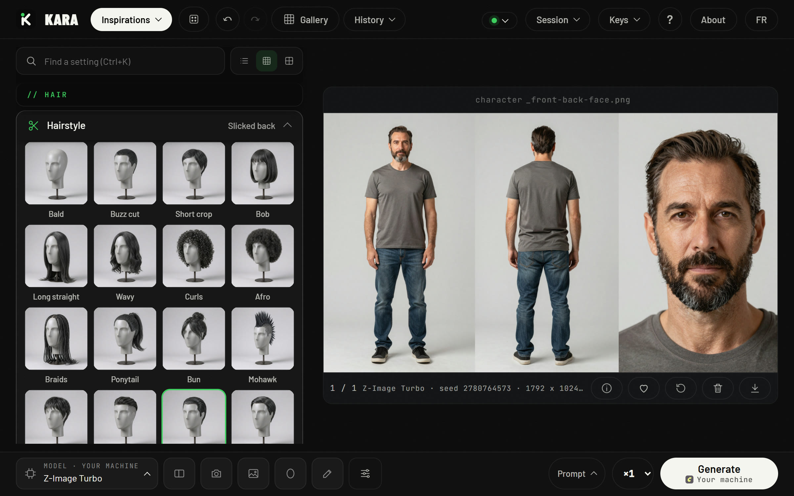
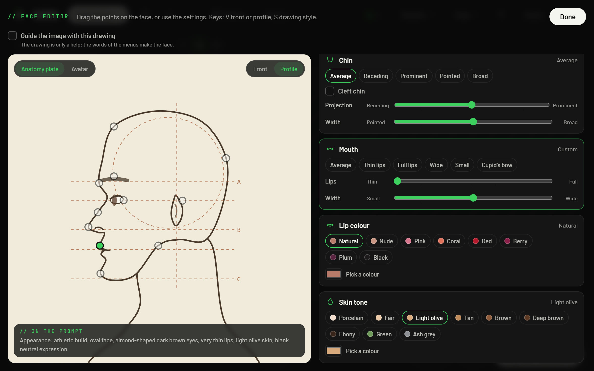

# Kara // character designer

**Design a character with menus, not prompts.** Kara is an open source character designer: pick a gender, an age, a face, a hairstyle, an outfit, an expression, and it writes the prompt, sends it to the image model you choose, and gives you a clean character sheet (front and back full body plus a face close-up, or nine other layouts) ready for a game, a comic, a film or a pitch.

It runs on **your own ComfyUI** for free, on **Comfy Router** with your Comfy key, or through another API provider with your own key. No account, no subscription, nothing stored on a server.



- **Menus, not prompts.** Every choice has a picture. Identity, body, face, hair (28 hairstyles), outfit, accessories, expression (a Plutchik emotion wheel), look and background: each menu adds its own words to the prompt, and you can always type your own. A search box (Ctrl+K) finds any setting.
- **A real face editor.** A live drawing of the face, front or profile, as an anatomy plate or a flat avatar. Drag the points (face width and length, jaw, forehead, brows, eye spacing, size and tilt, nose, mouth and lips, ears, chin): the sliders and the prompt follow, and the sentences sent to the model are shown under the drawing.
- **10 sheet layouts, 8 looks.** Front, back and face; three-quarter portrait plus full body; turnaround; face from three angles; portrait or full body alone, front, three-quarter or profile. Photoreal, cinematic, illustration, stylized 3D, anime, comics, oil painting or watercolor.
- **Your references.** Drop one or several pictures of a character to get its sheet, or use pictures only for the outfit, the accessories or the visual style. Kara counts every image it will send and greys out the ones a model cannot take.
- **20 models, 5 providers, prices up front.** The model window shows each provider in turn (your own machine, Comfy Router, KIE, fal, Magnific), greys out the models it does not offer and gives the price under each one. The menu at the top right shows the balance of each provider you have a key for.
- **Made for iteration.** Named history with undo and redo, batches of up to 4 images, seed control, a gallery with favourites and batches, a full screen viewer with zoom and minimap, and a one-file export of the whole session (images included).
- **Bilingual** (English and French), works on desktop, tablet and phone.



## Built on the Comfy Developer Platform

Kara is a real app, not a workflow export: a small Node.js server and a plain HTML, CSS and JavaScript page, with **zero npm dependencies** and no build step. It uses two parts of Comfy:

- **ComfyUI's API on your own machine** (open weights, free): the workflows below.
- **Comfy Router** (`api.comfy.org/v2/models`): one Comfy API key for Nano Banana, GPT Image, Seedream 5, FLUX 3, Krea 3 and Ideogram 4.5, paid in Comfy credits. Kara queues each request, follows its status and brings the image back (`lib/router.js`).

On your own machine, Kara talks to ComfyUI through its API: it loads a workflow in API format from `workflows/`, finds the prompt, seed, size and image nodes by what they are (not by number), fills them in, uploads your reference images, queues the job and brings the image back. The workflows are the official ComfyUI templates, untouched:

| Model | Workflow | With reference images |
| --- | --- | --- |
| Z-Image Turbo | `zimage_turbo_t2i.api.json` | Face drawing as a ControlNet guide: `zimage_turbo_guide.api.json` (Z-Image Turbo Fun Union ControlNet) |
| FLUX 3 Klein | `flux3_klein_t2i.api.json` | `flux3_klein_edit.api.json`, up to 10 images |
| Qwen-Image 2.1 | `qwen_image_2_1_t2i.api.json` | `qwen_image_2_1_edit.api.json`, up to 10 images |
| MOSS-Image | `moss_image_t2i.api.json` | text only |

Drop any other text-to-image workflow exported with **Workflow > Export (API)** into `workflows/` and Kara can use it.

With an API model, the face drawing is sent as a reference image instead, so the face editor steers every model that takes images.

## Download

Nothing else to install: each file carries its own Node.js and opens Kara in a window of its own.

- **Windows:** [Kara-Setup.exe](https://github.com/DashDashDesign/Kara/releases/latest/download/Kara-Setup.exe). No admin rights needed; it adds Kara to the Start menu and the desktop. It is not signed yet, so Windows SmartScreen warns: click **More info**, then **Run anyway**.
- **macOS:** [Kara.dmg](https://github.com/DashDashDesign/Kara/releases/latest/download/Kara.dmg) (Apple Silicon and Intel). Drag Kara to Applications. It is not signed by Apple: the first time, right-click Kara and choose **Open**, or allow it in **System Settings > Privacy & Security**. The Mac version is built and checked by GitHub Actions on a Mac runner, but has not been tried on a real Mac yet.

Kara opens in Chrome or Edge as an app window when one is installed, else in your default browser.

## Install in one line

Windows (PowerShell):

```
irm https://raw.githubusercontent.com/DashDashDesign/Kara/main/install.ps1 | iex
```

macOS or Linux (Terminal):

```
curl -fsSL https://raw.githubusercontent.com/DashDashDesign/Kara/main/install.sh | sh
```

The script checks Node.js 18+ (on Windows it installs it with winget if needed), downloads the latest version, keeps your settings and keys, and opens Kara at http://localhost:3210. Windows also gets a desktop shortcut. To update later: **About > Update** in the app.

Or by hand: clone this repository, then `npm start` (or double-click `start.bat` on Windows).

## Run the models

Open **Keys** at the top right of the app. Each provider has its card; a key is saved in a local `.env` file and never sent back to the page.

| Provider | What you need | Models |
| --- | --- | --- |
| **Your own machine** (ComfyUI) | ComfyUI running on `http://127.0.0.1:8188` (the address can be changed in Keys) and an NVIDIA GPU. The **Install the model** button downloads the Z-Image Turbo files (and its ControlNet) into your ComfyUI folders. | Z-Image Turbo, FLUX 3 Klein, Qwen-Image 2.1, MOSS-Image. Free. |
| **Comfy Router** | A Comfy API key (platform.comfy.org) and Comfy credits, no subscription | Nano Banana (Pro, 2.1, 2, 2 Lite, first version), GPT Image (all three), Seedream 5 (Pro, Lite, Flash), FLUX 3, Krea 3, Ideogram 4.5 |
| **KIE** (kie.ai) | An API key | Nano Banana (Pro, 2.1, 2, 2 Lite, first version), GPT Image 2, 2.5 Flare and 2.5 Sunburst, Seedream 5 (Pro, Lite, Flash), Qwen-Image 3, 3 Pro and 2.1, FLUX 3 Klein, Z-Image Turbo |
| **fal** (fal.ai) | An API key | Nano Banana (all five), GPT Image (all three), Seedream 5 (all three), FLUX 3 and FLUX 3 Klein, Krea 3, Ideogram 4.5, MOSS-Image, Z-Image Turbo |
| **Magnific** | An API key | Nano Banana (Pro, 2.1, 2, first version), GPT Image (all three), Seedream 5 Pro and Lite, Ideogram 4.5, Z-Image Turbo |

When a model exists at several providers, Kara uses the first one you have a key for and remembers your choice per model. Every image keeps the name of the provider that made it.

Models with open weights are marked **Open** in the model window, the others **API**. Each model keeps its own license; this repository contains no model.

## Online version

Kara also runs as a Cloudflare Worker: https://kara.dashdash.design

Bring your own key (Magnific, KIE or fal): it is kept in your browser, sent with each request and never stored on the server. Images are served through signed links only.

To deploy your own copy: `npx wrangler deploy` (see `wrangler.jsonc`). Nothing is installed in this folder; `npx` fetches Wrangler on demand.

## What has been tested for real

Honest status on October 29, 2026:

- **Tested for real:** a full character sheet generated from the app with Z-Image Turbo on a local ComfyUI (ComfyUI Desktop, NVIDIA GPU with 24 GB); the online version with a Magnific key; reading a KIE balance from the app; the face drawing as a ControlNet guide on a local ComfyUI, with the ControlNet installed by the app. The screenshot at the top is that local generation.
- **Not tested for real yet:** Comfy Router (written from its documentation and tested against a fake Router; no Comfy key was at hand), the FLUX 3 Klein, Qwen-Image 2.1 and MOSS-Image workflows started from the app, the one-line installers and the updater (they need this repository to be public).

Everything else is covered by the test suite below, against fake servers.

## How it works

```
page (public/)  ->  server.js  ->  ComfyUI on your own machine, Comfy Router, KIE, fal or Magnific
```

- `data/options.json`: every menu, in English and French, with the words each choice adds to the prompt and the slider positions of the face.
- `data/presets.json`: the starting characters (Inspirations).
- `data/models.json`: the models, what each provider offers (sizes, ratios, reference images, price).
- `lib/prompt.js`: builds the prompt from the choices, numbers the reference images in the order they are sent.
- `lib/comfy.js`: talks to ComfyUI and Comfy Cloud, fills the workflow, uploads images. `lib/router.js`: Comfy Router. `lib/kie.js`, `lib/fal.js`, `lib/magnific.js`: the API providers.
- `worker/index.js`: the same API for Cloudflare.
- `public/`: the interface. The thumbnails were made once with image models, so the menus show a picture of each choice (grey mannequins, so the pictures never suggest a gender or a face).

## Tests

```
npm test
```

Starts a fake ComfyUI, a fake Comfy Cloud and fake API providers, then checks the menus, the prompt, the values written into each workflow, image uploads, the ControlNet guide, job tracking, error messages, key handling, the installer and the updater (63 checks).

`npm run mock` starts only the fake ComfyUI, to try the interface without a GPU.

## License

MIT, see [LICENSE](LICENSE). Made by [Dash Dash](https://dashdash.design).
